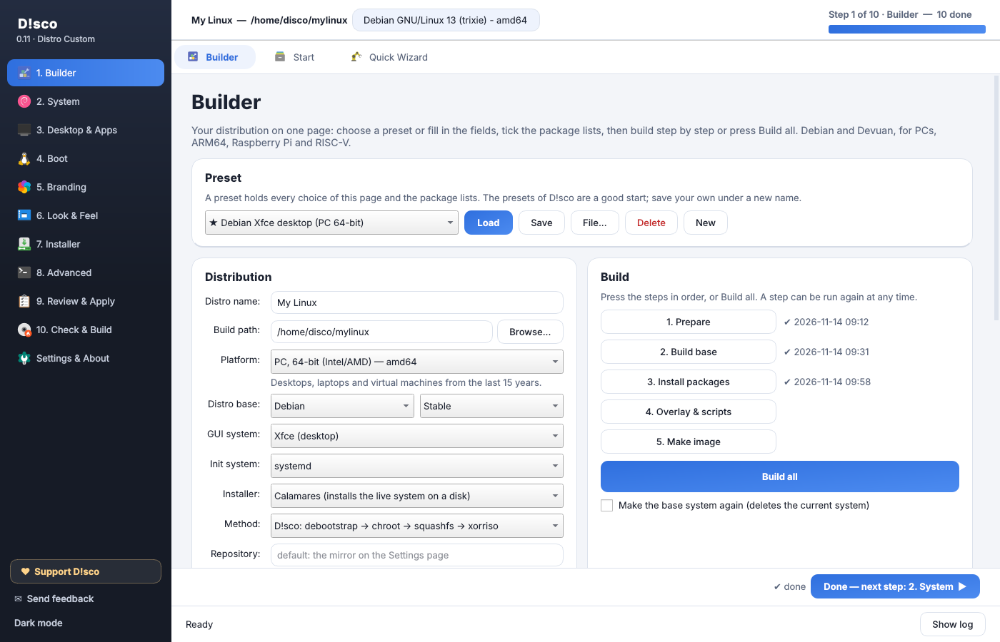

# D!sco 0.11 — Distro Custom


**D!sco (Distro Custom)** builds **your own Linux distribution** from **Debian** (stable, testing, sid)
or **Devuan**, for **PCs, 64-bit ARM, the Raspberry Pi and RISC-V**. It uses Debian's own tools only —
`debootstrap`/`mmdebstrap`, `chroot`, `mksquashfs`, `xorriso` and, if you like, `live-build` — and
nothing of Ubuntu (no casper, no PPAs, no Ubuntu bases).

Choose a preset, tick the package lists, press **Build all**: D!sco makes the base system, installs the
desktop and your programs, copies your files, runs your scripts and writes a **hybrid live ISO** (BIOS +
UEFI, with the Calamares installer) or an **SD-card image** for the Raspberry Pi. Every part can then be
refined: identity and the files of `/etc`, users, language, kernel, boot loaders, boot menu, Plymouth,
login screen, themes, sounds, a welcome screen, the bash prompt, browser policies, a PDF about your system
on every desktop, and the installer.



**Step-by-step guide (PDF):** [docs/Disco-Guide.pdf](docs/Disco-Guide.pdf) ·
**Same guide as text:** [docs/manual.md](docs/manual.md) ·
**Panduan singkat (Bahasa Indonesia):** [docs/PANDUAN.md](docs/PANDUAN.md)

**Support the project:** [Donate with PayPal](https://paypal.me/hugocenturion0311) ·
[Facebook](https://facebook.com/hugomonizdorego)

> D!sco is free and open source software (GPL-3.0-or-later). It was called **DistroForge** (0.9 Beta)
> and **Eduka-Customizer** (up to 0.17 Alpha); the version numbers start again with D!sco (0.11 = November).
> It is not affiliated with Debian, Devuan or Raspberry Pi Ltd.

## What it builds

| Platform | Processor | Kernel | Result |
|---|---|---|---|
| PC, 64-bit (Intel/AMD) | amd64 | linux-image-amd64 | ISO, BIOS + UEFI (+ Secure Boot) |
| Older PC, 32-bit (Debian 12) | i386 | linux-image-686-pae | ISO, BIOS + UEFI |
| ARM 64-bit with UEFI | arm64 | linux-image-arm64 | ISO, UEFI (GPT EFI partition for USB) |
| Raspberry Pi 3, 4, 400 | arm64 | linux-image-arm64 | SD-card image |
| Raspberry Pi 5 (experimental) | arm64 | linux-image-arm64 | SD-card image |
| Raspberry Pi 2, 3 (32-bit) | armhf | linux-image-armmp | SD-card image |
| Raspberry Pi 1, Zero, Zero W | armel | linux-image-rpi | SD-card image |
| RISC-V 64 with UEFI (experimental) | riscv64 | linux-image-riscv64 | ISO, UEFI |

Bases for another processor are made on your computer through **qemu-user** (binfmt_misc): mmdebstrap,
debootstrap and the chroot work exactly as for a PC. SD-card images are laid out like Debian's own Raspberry
Pi images (`RASPIFIRM` FAT boot partition written by Debian's `raspi-firmware`, `RASPIROOT` ext4 system
partition that grows to the whole card at the first start, `sysconf.txt` for the host name and an SSH key).

## New in 0.11

* **Builder** (step 1), in the spirit of the classic distro builders but modern: **presets** (Load, Save,
  File, Delete, New), distro name, build path, **platform**, Debian/Devuan release, desktop, init system,
  installer, method and repository; **application package lists** with tick boxes and a catalog of programs
  by category; the steps **Prepare → Build base → Install packages → Overlay & scripts → Make image**, or
  **Build all**; QEMU, a chroot terminal, the desktop in a window, Synaptic and tools.
* **ARM64, Raspberry Pi and RISC-V** (see the table), **SD-card images** without loop devices, ARM64/RISC-V
  UEFI ISOs, QEMU tests for ARM.
* **live-build route**: D!sco writes `auto/config`, the package lists, includes and hooks, and runs
  `lb config` / `lb build` (Debian's live-build).
* **System files**: `os-release` (with `LOGO`), `lsb-release`, `issue` ("Welcome to ..."), `issue.net`,
  `hostname`, `hosts`, `motd`; the picture of new users and settings folders into `/etc/skel`;
  `GRUB_BACKGROUND` of installed systems.
* **Terminal & Browser**: message after login (static or dynamic), bash prompt presets, **Firefox ESR and
  Chromium policies** (home page, lock, bookmarks, telemetry, search engine).
* **Desktop document**: a PDF about your system with **any title**, put on every user's desktop at the first
  login and into the menu.
* **Installer**: Calamares, none (live only) or **your own .deb packages**.
* **Ten steps** in the sidebar, each with its pages as tabs; a new icon.
* About 50 fixes from a full code review (see [CHANGELOG.md](CHANGELOG.md)).

## Install

```sh
sudo apt install ./disco_0.11_all.deb
sudo apt install qemu-user-static binfmt-support    # to build for ARM or RISC-V on a PC
sudo apt install live-build                          # optional: the live-build route
```

Start **D!sco** from the menu, or `disco` in a terminal (it asks for the administrator password). D!sco
runs on Debian 12 or newer and Debian derivatives; it needs about 4 GB of memory and free disk space of
three times the finished image.

## Quick start

1. **1. Builder** → choose a preset (for example *Debian Xfce desktop (PC 64-bit)* or *Raspberry Pi
   desktop*) → **Load**.
2. Type the distro name; check the build path.
3. Tick the package lists (double-click a list to add programs from the catalog).
4. **Prepare** — it lists anything missing on this computer with the command that installs it.
5. **Build all**.
6. **Test in QEMU**, then write the image (check the device with `lsblk` first):

```sh
sudo dd if=mylinux-1.0-stable-amd64.iso of=/dev/sdX bs=4M status=progress oflag=sync
xzcat mypi-1.0-stable-arm64.img.xz | sudo dd of=/dev/sdX bs=4M status=progress conv=fsync
```

> **Warning:** `dd` overwrites the whole device named in `of=`. A wrong letter erases your own disk.

## Command line

```sh
sudo disco new --preset "Raspberry Pi desktop (Pi 3, 4, 400)" /home/disco/mypi
cd /home/disco/mypi
sudo disco builder --name "My Pi Linux" --desktop xfce
sudo disco lists add applications thonny python3-gpiozero
sudo disco build-all
sudo disco test
disco platforms        # what D!sco builds for
disco presets          # the presets
disco --help           # every command
```

## Building from source

```sh
make check             # tests (pytest)
make install           # into /usr/local
dpkg-buildpackage -us -uc -b     # the Debian package
QT_QPA_PLATFORM=offscreen python3 tools/screenshots.py    # the screenshots of the guide
QT_QPA_PLATFORM=offscreen python3 tools/make_guide.py     # docs/Disco-Guide.pdf and docs/manual.md
```

The code: `disco/core` (everything that changes or builds a system, usable without the GUI),
`disco/gui` (PyQt6, PyQt5 as fallback), `disco/cli.py`, `data/` (catalogs, presets, scripts that go into the
images), `tests/`.

## History

D!sco is a complete rewrite of *Customizer* (Ivailo Monev, Mubiin Kimura, Graham Cantin and contributors) and
takes ideas from *Cubic*, *remastersys*, *penguins-eggs* and the classic distro builders. Its earlier names
were Eduka-Customizer (0.10–0.17 Alpha) and DistroForge (0.9 Beta); see [CHANGELOG.md](CHANGELOG.md) and
[docs/ROADMAP.md](docs/ROADMAP.md).

## License

GPL-3.0-or-later. Menu icons: Papirus (GPL-3.0) and own icons (GPL-3.0-or-later), see
`data/icons/menu/README.md`. Debian is a registered trademark of Software in the Public Interest, Inc.;
Raspberry Pi is a trademark of Raspberry Pi Ltd; Linux® is the registered trademark of Linus Torvalds.
