# D!sco Step-by-step Guide · 0.11

Build your own Debian or Devuan distribution for PCs, ARM64, Raspberry Pi and RISC-V.

The same guide as a PDF with pictures: [Disco-Guide.pdf](Disco-Guide.pdf).

## Contents

1. What is D!sco?
2. Installing D!sco
3. Quick start: a distribution in six clicks
4. Step 1 · The Builder
5. Package lists and the catalog
6. The build steps in detail
7. ARM, Raspberry Pi and RISC-V
8. Debian and Devuan repositories
9. The live-build route
10. Step 2 · System
11. Step 3 · Desktop & Apps
12. Step 4 · Boot
13. Step 5 · Branding
14. Step 6 · Look & Feel
15. Step 7 · Installer
16. Steps 8 to 10 · Advanced, Review & Apply, Check & Build
17. Testing and writing the ISO
18. Command line
19. Troubleshooting
20. Cleaning up
21. License, trademarks and support

## 1. What is D!sco?

**D!sco (Distro Custom)** is free and open source software (GPL-3.0-or-later) to build your own Linux distribution from **Debian** (stable, testing, sid) or **Devuan**. It uses Debian's own tools only: `debootstrap` or `mmdebstrap`, `chroot`, `mksquashfs`, `xorriso` and, if you like, `live-build`. Nothing of Ubuntu is used: no casper, no PPAs, no Ubuntu bases.

The result is a **hybrid live ISO** (BIOS and UEFI) for PCs and UEFI machines, installed with Calamares, or an **SD-card image** for the Raspberry Pi. Other processors are built on your computer through **qemu-user**.

| Platform | Processor | Kernel package | Result |
|---|---|---|---|
| PC, 64-bit | amd64 | linux-image-amd64 | ISO (BIOS + UEFI) |
| Older PC, 32-bit (Debian 12) | i386 | linux-image-686-pae | ISO (BIOS + UEFI) |
| ARM 64-bit with UEFI | arm64 | linux-image-arm64 | ISO (UEFI) |
| Raspberry Pi 3, 4, 400 | arm64 | linux-image-arm64 | SD-card image |
| Raspberry Pi 5 (experimental) | arm64 | linux-image-arm64 | SD-card image |
| Raspberry Pi 2, 3 (32-bit) | armhf | linux-image-armmp | SD-card image |
| Raspberry Pi 1, Zero, Zero W | armel | linux-image-rpi | SD-card image |
| RISC-V 64 with UEFI (experimental) | riscv64 | linux-image-riscv64 | ISO (UEFI) |

The work is split into **ten steps** in the sidebar; each step has its pages as tabs. Step 1, the **Builder**, can build the whole distribution on its own with **Build all**; the other steps refine it.

- 1 Builder · 2 System · 3 Desktop & Apps · 4 Boot · 5 Branding
- 6 Look & Feel · 7 Installer · 8 Advanced · 9 Review & Apply · 10 Check & Build


## 2. Installing D!sco

1. Install the package and every tool it needs:
2. For other processors (ARM64, Raspberry Pi, RISC-V) also install qemu-user and binfmt:
3. For the live-build route install Debian's live-build:
4. Start D!sco from the menu (**D!sco**) or a terminal.

```sh
sudo apt install ./disco_0.11_all.deb
sudo apt install qemu-user-static binfmt-support      # ARM and RISC-V
sudo apt install live-build                            # optional
disco                  # the window (asks for the administrator password)
sudo disco --help      # the command line
```

Needs Debian 12 or newer (or a derivative), 4 GB of memory and free disk space of about three times the size of the finished image. The old commands `distroforge` and `eduka-customizer` still open D!sco; old settings are read automatically.


## 3. Quick start: a distribution in six clicks

1. Open **1. Builder**. Choose a preset, for example **Debian Xfce desktop (PC 64-bit)** or **Raspberry Pi desktop**, and press **Load**.
2. Type the **Distro name** and check the **Build path** (one folder per distribution).
3. Tick the package lists you want (double-click a list to add programs from the catalog).
4. Press **Prepare**: D!sco checks the choices and this computer and lists what is missing.
5. Press **Build all**. It makes the base system, installs the desktop and the lists, copies the overlay, runs your scripts and makes the ISO or SD-card image.
6. Test it in QEMU (**Test in QEMU**) and write it to a USB stick or SD card.

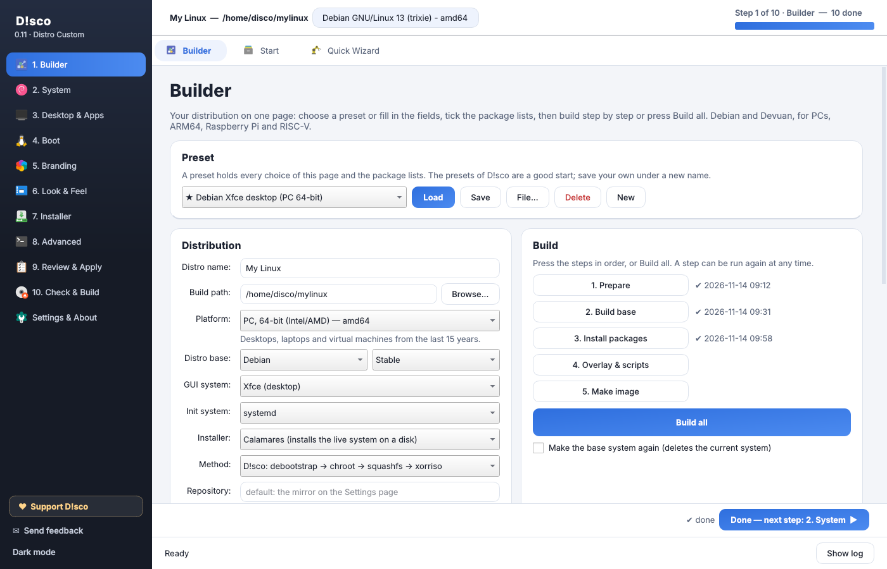


## 4. Step 1 · The Builder

The Builder holds the whole distribution, like the classic distro builders, in one modern page:

| Field | What it is |
|---|---|
| Preset | Load, Save, File (import/export), Delete, New. ★ presets come with D!sco. |
| Distro name | The name of your distribution (os-release, boot menu, installer). |
| Build path | The project folder: system, lists, overlay, scripts and output. |
| Platform | What the system is for: PC, ARM64, Raspberry Pi, RISC-V (see chapter 1). |
| Distro base | Debian or Devuan, and the release: stable, testing, sid or oldstable. |
| GUI system | A desktop (Xfce, GNOME, KDE Plasma, ...), a window manager, or none. |
| Init system | systemd, SysVinit, OpenRC or runit (Devuan: never systemd). |
| Installer | Calamares, none (live only) or your own .deb packages. |
| Method | D!sco (debootstrap → chroot → squashfs → xorriso) or Debian live-build. |
| Repository | Another Debian or Devuan mirror (default: the Settings page). |

The **Build** card shows the five steps and when each one was last finished. A step can be run again at any time, for example **Install packages** after changing a list.

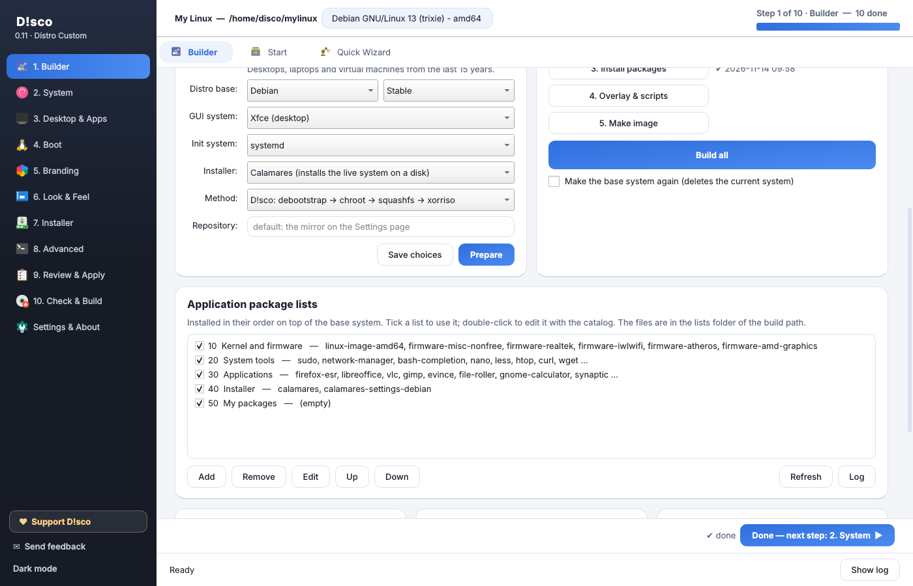

Under the lists: **Edit / view** (repositories, overlay folder, scripts, system files), **After the build** (QEMU, a terminal in the system, the desktop in a window, Synaptic) and **Tools** (open the build folder, unmount everything, delete the build, this guide).

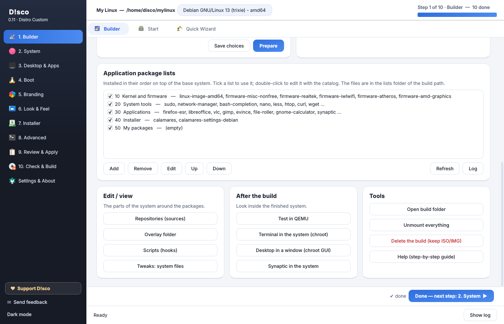


## 5. Package lists and the catalog

Each list is a plain text file in `lists/` of the build path, installed in the order of its number. One Debian package per line; `#` starts a comment and `-name` removes a package. Lists that are switched off stay in the folder.

```sh
# Title: Applications
# Programs for the menu: tick them in the catalog or type their names.
firefox-esr
libreoffice
vlc
-nano
```

Double-click a list (or press **Edit**) to tick programs in the catalog: Internet, Office, Graphics, Audio & Video, Education & Science, Programming, System Tools, Accessories, Games, Electronics & Raspberry Pi, Accessibility and Network & Server. Packages that your release or processor does not have are skipped with a note instead of stopping the build.

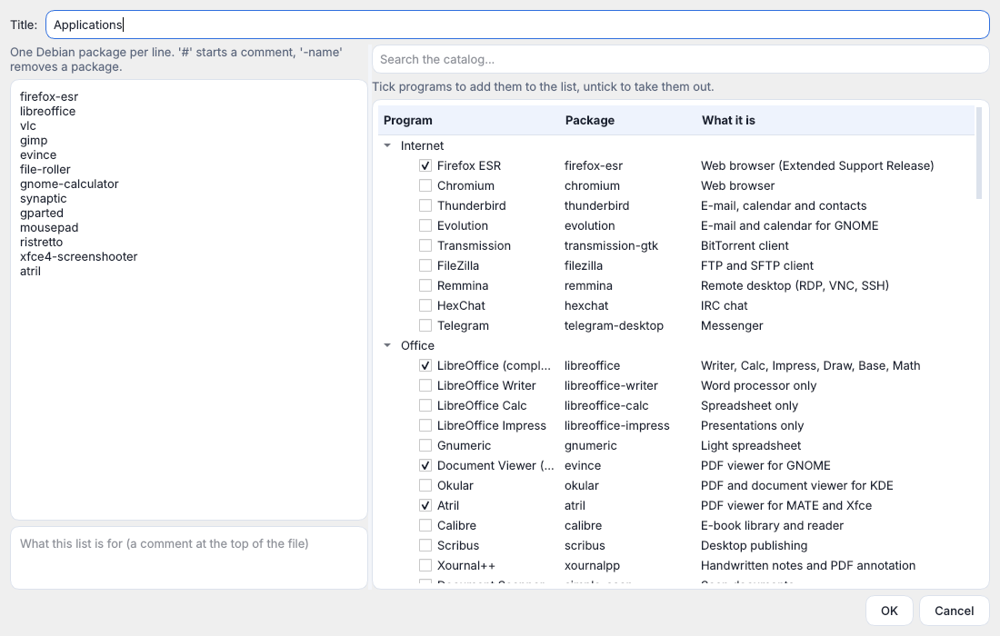


## 6. The build steps in detail

1. **Prepare** writes the first lists, makes the folders `lists`, `overlay`, `hooks` and `debs`, switches qemu-user on for other processors and lists every missing tool with the command that installs it.
2. **Build base** makes a new system with mmdebstrap (or debootstrap), checks the Debian keyring, gives the system its own host name and empty resolv.conf, switches to the chosen init system and writes the name of your distribution.
3. **Install packages** installs the desktop, every list that is on, and the installer.
4. **Overlay & scripts** copies `overlay/` into the system (owner root) and runs every `hooks/*.sh` inside it, in name order.
5. **Make image** cleans the system, makes the initramfs and builds the ISO or the SD-card image.

What **Build base** does, by hand:

```sh
sudo mmdebstrap --variant=important --architectures=amd64 \
    --components=main,contrib,non-free,non-free-firmware \
    --include=systemd-sysv,live-boot,live-config,linux-image-amd64 \
    --include=sudo,network-manager \
    trixie /home/disco/mylinux/rootfs http://deb.debian.org/debian
```

The overlay folder mirrors the system: `overlay/etc/skel/.bashrc` becomes `/etc/skel/.bashrc`. A script in `hooks/` runs as root inside the system:

```
#!/bin/sh
# hooks/20-defaults.sh
set -e
apt-get install -y --no-install-recommends fastfetch
echo 'fastfetch' >> /etc/skel/.bashrc
```


## 7. ARM, Raspberry Pi and RISC-V

On a PC, the programs of an ARM or RISC-V system run through **qemu-user** with binfmt_misc. D!sco switches it on itself; to check it by hand:

```sh
sudo apt install qemu-user-static binfmt-support
update-binfmts --display qemu-aarch64     # 'enabled', flags include F
ls /proc/sys/fs/binfmt_misc/               # qemu-aarch64, qemu-arm, qemu-riscv64
```

**Raspberry Pi images** are laid out like Debian's own:

| Partition | Label | File system | Holds |
|---|---|---|---|
| 1 (from 4 MiB) | RASPIFIRM | FAT32 | firmware, kernel, initrd, device trees, config.txt, cmdline.txt, sysconf.txt |
| 2 | RASPIROOT | ext4 | the system; grows to the whole card at the first start |

Debian's `raspi-firmware` package writes the boot partition again after every kernel update. Your own lines are kept: config.txt lines in `/etc/default/raspi-firmware-custom`, kernel options in `/etc/default/raspi-extra-cmdline` (page **4. Boot → Raspberry Pi**).

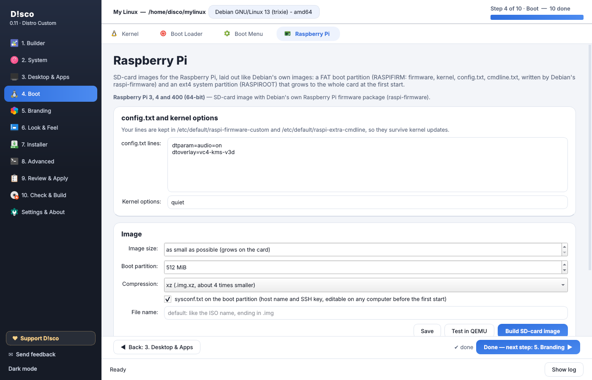

At the first start the card grows to its full size, new SSH host keys and a machine id are made, and `sysconf.txt` on the boot partition is read (edit it on any computer before the first start):

```sh
hostname=mypi
root_authorized_key=ssh-ed25519 AAAA... you@laptop
```

Write the card (the image is compressed with xz):

```sh
# find the card, for example /dev/mmcblk0 or /dev/sdb
lsblk
xzcat mylinux-1.0-stable-arm64.img.xz | \
    sudo dd of=/dev/sdX bs=4M status=progress conv=fsync
```

> **WARNING: dd overwrites the WHOLE device named in of= without asking. Check the name with lsblk (unplug and plug the card to see which name appears) and never name the disk of your computer. Raspberry Pi Imager (Use custom) and GNOME Disks (Restore Disk Image) are safer.**

**ARM64 and RISC-V ISOs** start with UEFI only: D!sco makes GRUB for the processor (`grub-mkstandalone -O arm64-efi`, `bootaa64.efi`) and gives the ISO a GPT with an EFI partition, so it also starts from a USB stick.


## 8. Debian and Devuan repositories

| Suite | Debian | Devuan | Notes |
|---|---|---|---|
| oldstable | bookworm (12) | daedalus (5) | 32-bit PCs; turn on in Settings for others |
| stable | trixie (13) | excalibur (6) | recommended |
| testing | forky | freia | newer, changes every day |
| unstable | sid | ceres | for developers |

| Repository | Address |
|---|---|
| Debian | http://deb.debian.org/debian |
| Debian security | http://security.debian.org/debian-security |
| Devuan (all) | http://deb.devuan.org/merged |
| Debian backports | http://deb.debian.org/debian (suite trixie-backports) |

D!sco writes clean deb822 files, for example `/etc/apt/sources.list.d/debian.sources`:

```
Types: deb
URIs: http://deb.debian.org/debian
Suites: trixie trixie-updates
Components: main contrib non-free non-free-firmware
Signed-By: /usr/share/keyrings/debian-archive-keyring.gpg
```

A third-party repository always gets its own key (page **2. System → Repositories → Add**):

```sh
wget -qO- https://repo.example.org/key.asc | gpg --dearmor | \
    sudo tee /etc/apt/keyrings/example.gpg >/dev/null
# Signed-By: /etc/apt/keyrings/example.gpg in the .sources file
```


## 9. The live-build route

Choose **Method: Debian live-build** on the Builder (ISO platforms with Debian only). D!sco writes `live-build/` in the build path and runs it:

- `auto/config` — `lb config` with every choice (release, architecture, kernel flavour, archive areas, boot loaders, compression, boot options)
- `config/package-lists/*.list.chroot` — your lists, the desktop and the live system
- `config/includes.chroot/` — the overlay folder
- `config/hooks/normal/*.hook.chroot` — your scripts, the name of the system and the packages the lists remove

The same by hand (you can change the files first):

```sh
cd /home/disco/mylinux/live-build
sudo lb clean
sudo lb config
sudo lb build
```

Debian's live-build of 2021 or later is needed (Debian 11+): D!sco checks the version.


## 10. Step 2 · System

Tabs: **Repositories**, **Identity**, **System files**, **Users**, **Language** and **Init System**.

**System files** edits the files that tell who the system is. **Template from Identity** fills a file from the Identity tab; change it as you like, then **Save to the system**.

| File | Example |
|---|---|
| /etc/os-release | NAME="My Linux" · VERSION="1.0 (Aurora)" · ID=mylinux · PRETTY_NAME="My Linux 1.0 (Aurora)" · HOME_URL=... · LOGO=mylinux-logo |
| /etc/lsb-release | DISTRIB_ID="My Linux" · DISTRIB_RELEASE=1.0 · DISTRIB_DESCRIPTION="My Linux 1.0" |
| /etc/issue | Welcome to My Linux 1.0 - \n \l |
| /etc/issue.net | Welcome to My Linux 1.0 |
| /etc/hostname, /etc/hosts | mylinux · 127.0.1.1 mylinux |
| /etc/motd | the message after logging in |

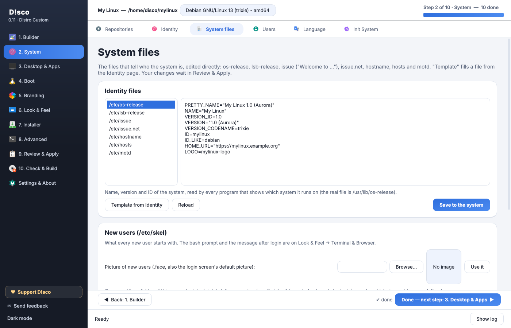

Below: the **picture of new users** (`/etc/skel/.face`, also the login screen's default picture), **settings folders** copied from this computer into /etc/skel (for example `~/.config/xfce4`: panels and shortcuts; caches and keys stay out) and the **GRUB background** of installed computers (GRUB_BACKGROUND; the installer runs update-grub).

**Init System**: systemd, SysVinit, OpenRC or runit with elogind, the right live-config backend and init scripts; the installer follows. GNOME needs systemd.


## 11. Step 3 · Desktop & Apps

**Desktop**: a desktop or window manager in a Mini, Compact, Full or Full-with-apps edition; the login screen, X11 or Wayland and the compositor follow it. **Packages**: every package of the system. **Flatpak**: Flathub applications by category. **Replace Apps**: another browser, mail program, editor or terminal for everyone.

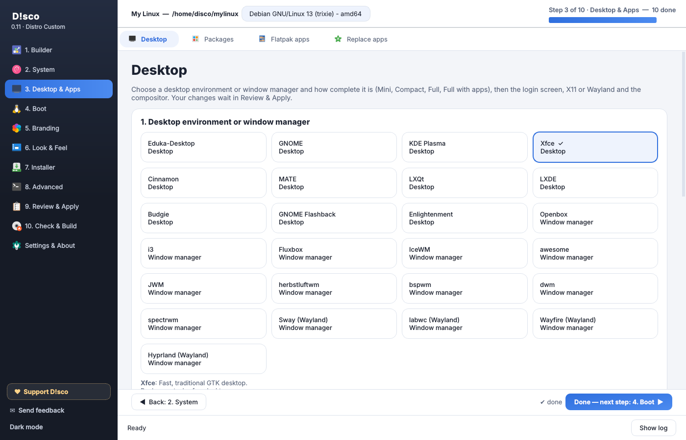


## 12. Step 4 · Boot

**Kernel**: Debian kernels, backports or third-party kernels (paste their instructions into the kernel terminal), firmware and the initramfs. **Boot Loader**: what installed computers start with (GRUB, GRUB with Secure Boot, systemd-boot, rEFInd, EFISTUB, Syslinux). **Boot Menu**: the menu of the ISO (title, timeout, background, GRUB theme, menu designer). **Raspberry Pi**: see chapter 7.

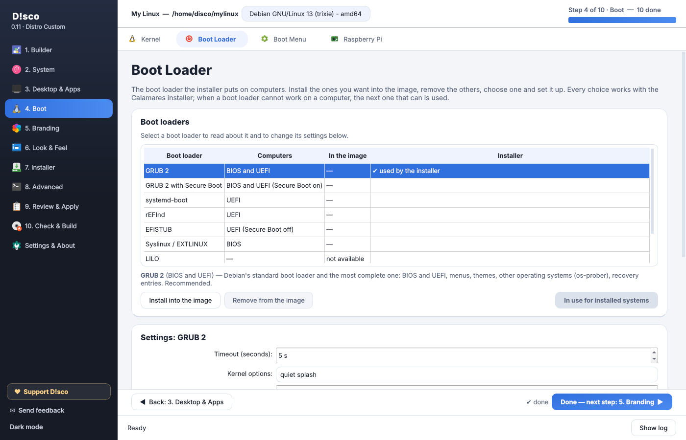

A broken or missing initramfs is made again with:

```sh
sudo disco run update-initramfs -c -k all
```


## 13. Step 5 · Branding

**Distro Branding** builds a package with your logo and name everywhere (base-files, lsb-release, desktop-base, logos, GRUB, Calamares). **Wallpaper & Login**: wallpapers and the LightDM greeter (`/etc/lightdm/lightdm-gtk-greeter.conf`: background, theme-name, icon-theme-name, default-user-image), SDDM and GDM. **Plymouth**: install, preview or make a boot splash from your logo; by hand:

```sh
sudo disco run plymouth-set-default-theme -R mytheme
```

**Desktop document**: a PDF about your system with the title you like. **Write a first text** describes the system from the project; change it freely. It is put into `/usr/share/doc/ID-guide/`, on every user's desktop at the first login (in the desktop folder of the user's language) and in the menu.

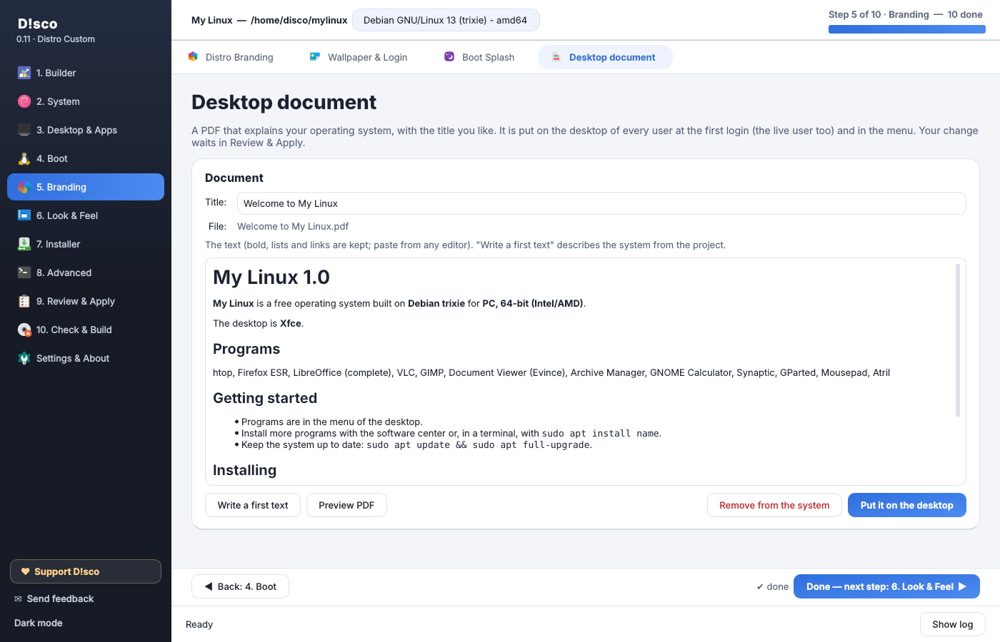


## 14. Step 6 · Look & Feel

**Themes & Icons**, **System Sounds**, **Welcome Screen** and **Terminal & Browser**.

**Terminal & Browser**: the message after login (a fixed `/etc/motd` or a dynamic script in `/etc/update-motd.d`), the bash prompt of every user (`/etc/bash.bashrc` and `/etc/skel/.bashrc`) and the policies of Firefox ESR and Chromium:

```
{
  "policies": {
    "Homepage": {"URL": "https://mylinux.example.org", "Locked": false},
    "Bookmarks": [{"Title": "Debian", "URL": "https://www.debian.org",
                   "Placement": "toolbar"}],
    "DisableTelemetry": true
  }
}
```

The file is written to `/etc/firefox-esr/policies/policies.json`, `/etc/firefox/policies/policies.json` and `/usr/lib/firefox-esr/distribution/policies.json`; Chromium's to `/etc/chromium/policies/managed/disco.json`.

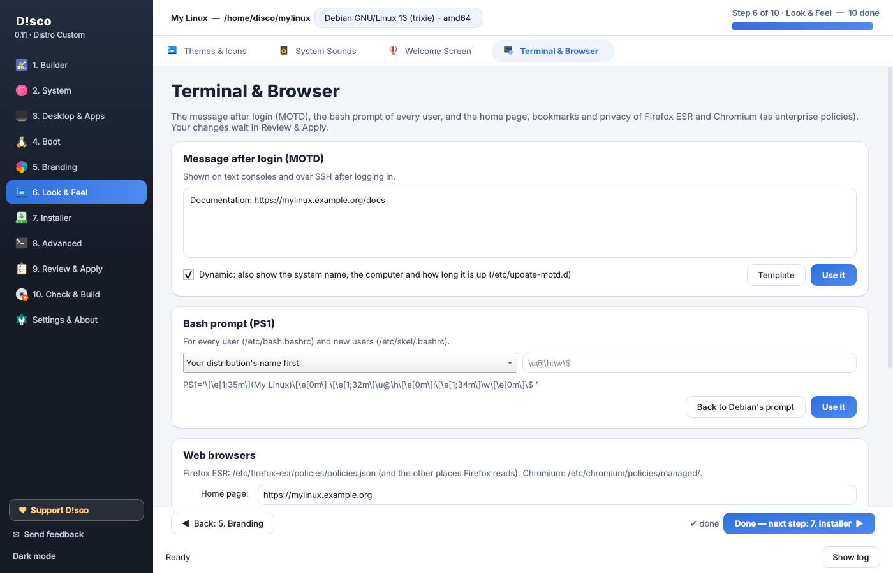


## 15. Step 7 · Installer

**Which installer**: Calamares (recommended), none (a live system only) or **your own .deb packages**: drop them on the page, they are kept in `debs/` and installed with their dependencies. Then the Calamares settings: name, images, colors, slides, users, partitions and **Check the installer**.

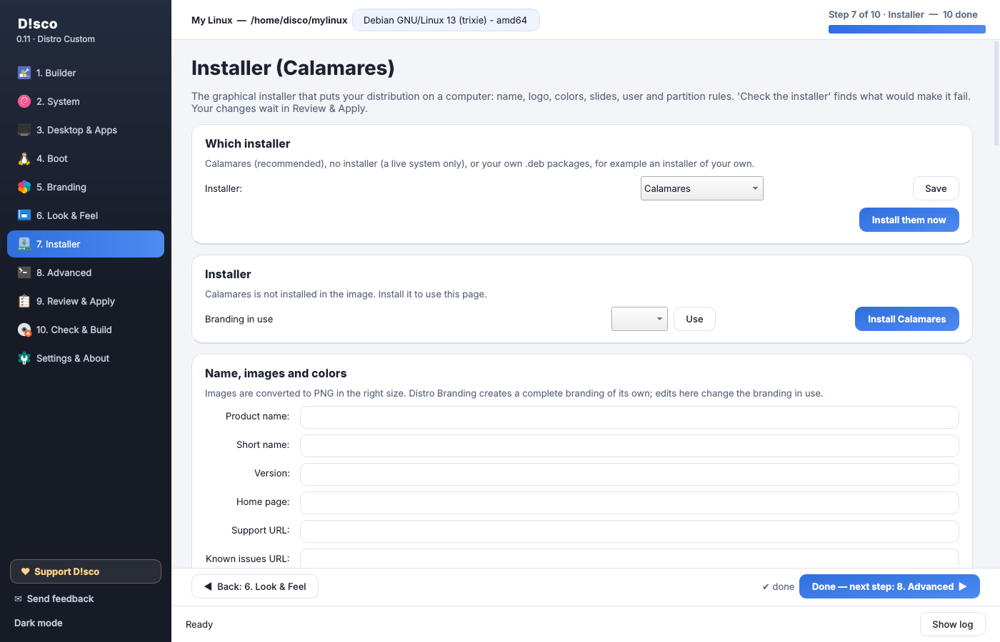


## 16. Steps 8 to 10 · Advanced, Review & Apply, Check & Build

**Advanced**: a terminal inside the system, the desktop in a window (Xephyr), hooks, recipes and the Package Workshop.

**Review & Apply**: changes of steps 2 to 8 wait here; tick them, try them in a preview, then apply them all at once. **Build all** on the Builder offers to apply them first.

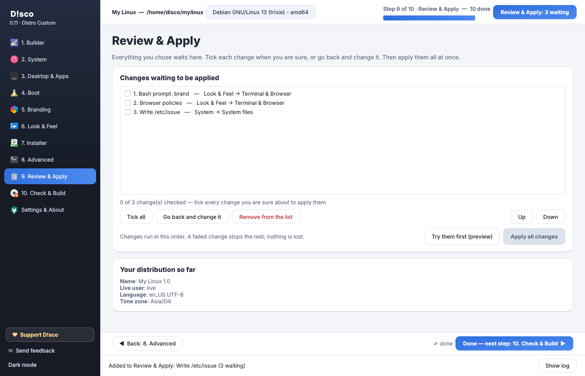

**Check & Build**: checks what would break the image (double-click a row to open its page, or **Fix automatically**), the target size, compression and the resources of this computer, then the ISO.


## 17. Testing and writing the ISO

**Test in QEMU** starts a PC ISO with BIOS, UEFI or Secure Boot, an ARM64 ISO with UEFI, and an SD-card image with its own kernel (ARM is emulated on a PC: be patient).

```sh
lsblk                     # find the USB stick, for example /dev/sdb
sudo dd if=mylinux-1.0-stable-amd64.iso of=/dev/sdX bs=4M status=progress oflag=sync
```

> **WARNING: dd erases everything on the device named in of=. A wrong letter erases your own disk: check it with lsblk first.**


## 18. Command line

Every step also works in a terminal:

```sh
sudo disco new --preset "Raspberry Pi desktop (Pi 3, 4, 400)" /home/disco/mypi
cd /home/disco/mypi
sudo disco builder --name "My Pi Linux" --desktop xfce
sudo disco lists show
sudo disco lists add applications thonny python3-gpiozero
sudo disco step prepare
sudo disco build-all
sudo disco test
disco platforms          # what D!sco builds for
disco presets            # the presets
sudo disco live-build export   # write the live-build configuration only
```

`disco --help` lists every command; `disco COMMAND --help` explains one.


## 19. Troubleshooting

| Problem | What to do |
|---|---|
| NO_PUBKEY / signature errors from APT | Install the keyring of the repository (Debian: debian-archive-keyring, Devuan: devuan-keyring) and use Signed-By in its .sources file. |
| Kernel panic or 'Unable to find a medium' at live boot | live-boot or the initramfs is missing: Install packages, then rebuild (Check & Build fixes it automatically). |
| initrd.img-VERSION is missing | disco run update-initramfs -c -k VERSION |
| ARM ISO does not start from USB | Built before 0.11: rebuild; the ISO now has a GPT EFI partition. |
| Exec format error in the chroot | qemu-user is not registered: sudo apt install qemu-user-static binfmt-support, then Prepare again. |
| raspi-firmware did not write the boot partition | D!sco writes it the same way and says so in the log; check that raspi-firmware is in the image (non-free-firmware). |
| The system is still in use | Close the terminal or live session of the system, or Tools → Unmount everything. |

Every message is in the log panel and in `/tmp/disco/disco.log`. **Send feedback** sends a report with screenshots and, if you agree, the logs.


## 20. Cleaning up

The build folders are big. **Delete the build (keep ISO/IMG)** on the Builder (or closing the window after a build, or `sudo disco clean --keep-iso`) deletes everything of the project but the images and their checksums. Nothing is deleted while anything is mounted inside the project.

> **WARNING: Never delete a project folder with rm -rf while a terminal or live session of it is open: /dev and /proc of your computer are mounted inside it. Use Unmount everything (or sudo disco clean) first.**


## 21. License, trademarks and support

D!sco is free software under the GNU General Public License version 3 or later, WITHOUT ANY WARRANTY. The licenses of its components are on the **About** tab. The packages in your distribution keep their own licenses (`/usr/share/doc/PACKAGE/copyright`).

Debian is a registered trademark of Software in the Public Interest, Inc.; Raspberry Pi is a trademark of Raspberry Pi Ltd; Linux® is the registered trademark of Linus Torvalds. D!sco is not affiliated with them. Give your distribution a name and logo of its own.

Made by Hugo Moniz do Rego. If D!sco helps you, a donation keeps the project going:

- PayPal: https://paypal.me/hugocenturion0311
- Facebook: https://facebook.com/hugomonizdorego
- Project: https://github.com/hugomonizdorego/Eduka-Customizer
