# D!sco Step-by-step Guide · 0.11.1

Customize a Debian live ISO into your own distribution: open the ISO, change what you like, press Finish.

The same guide as a PDF with pictures: [Disco-Guide.pdf](Disco-Guide.pdf).

## Contents

1. What is D!sco?
2. Before you start
3. Step 1 · Start
4. Moving through the steps
5. Step 2 · System
6. Step 3 · Software
7. Step 4 · Startup
8. Step 5 · Branding
9. Step 6 · Look & Feel
10. Step 7 · Boot
11. Step 8 · Installer
12. Step 9 · Files & Terminal
13. Step 10 · Review & Apply
14. Step 11 · Build: Finish
15. Testing and writing the image
16. Raspberry Pi, ARM64 and RISC-V
17. Command line
18. Troubleshooting
19. Cleaning up
20. License, trademarks and support

## 1. What is D!sco?

**D!sco (Distro Custom)** is free and open source software (GPL-3.0-or-later) that makes your own Linux distribution from a **Debian** or **Devuan** live ISO. It is made to be easy: you go through the steps with **Next**, change only what you want, and press **Finish**. The result is a live ISO (BIOS and UEFI) with the Calamares installer, or an SD-card image for the Raspberry Pi.

D!sco uses Debian's own tools only: `live-boot`, `mksquashfs`, `xorriso`, `mmdebstrap`/`debootstrap`, `chroot` and Calamares. Nothing of Ubuntu is used (no casper, no PPAs).

| Step | What you do there |
|---|---|
| Welcome | What D!sco does, recommendations, support. |
| 1 Start | Extract an ISO into a new project, or continue a project. |
| 2 System | Repositories, name of the system, system files, users, language. |
| 3 Software | Desktop, applications by category, Flatpak, default applications. |
| 4 Startup | What starts by itself: services and programs after login. |
| 5 Branding | Wallpaper and logo, login screen, boot splash, a PDF on every desktop. |
| 6 Look & Feel | Themes, sounds, welcome screen, terminal prompt and browser. |
| 7 Boot | Kernel, boot loader, boot menu, init system, Raspberry Pi. |
| 8 Installer | Calamares, no installer, or your own packages. |
| 9 Files & Terminal | Your folders (no root needed), the system as administrator, a terminal. |
| 10 Review & Apply | The list of your changes, applied all at once. |
| 11 Build | Finish: checks, then the ISO or SD-card image. |


## 2. Before you start

1. Install D!sco (it brings every tool it needs):
2. Connect to the internet. Extracting and editing work offline, but installing packages, desktops, Flatpak applications and kernels needs internet.
3. Download an ISO to start from. Recommended: the small **Debian live standard ISO** (no desktop), then add the desktop you want in step 3.
4. Start **D!sco** from the menu. It asks for the administrator password: it needs it to build systems.

```sh
sudo apt install ./disco_0.11.1_all.deb
```

| Recommended | Why |
|---|---|
| Internet connection | packages, desktops, Flatpaks, kernels, updates |
| Debian 12 or newer (or a Debian-based system) | the computer that runs D!sco |
| 4 GB of memory, about 20 GB free disk space | the system, the ISO and the compressed copy |
| The Debian live standard ISO | a small, clean start |

The **Welcome** page opens first. Untick **Show this page when D!sco starts** to go straight to Start next time. **Donate with PayPal** supports the project.

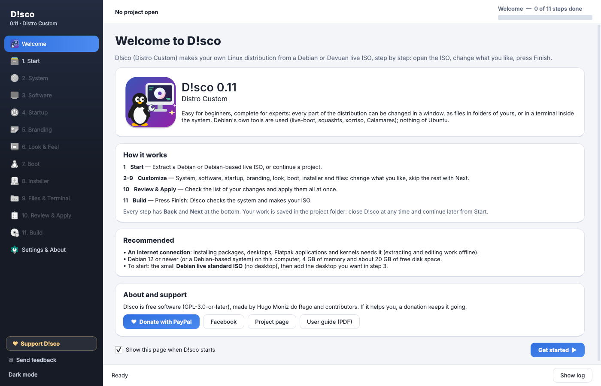


## 3. Step 1 · Start

**Customize an ISO** (left):

1. Press **Browse...** next to **ISO file** and choose the ISO.
2. Type a **Name** for your distribution; the **Folder** of the project follows it.
3. Optionally choose the **Language** of the system.
4. Press **Extract and start**. When it is done, D!sco opens step 2.

**Continue a project** (right): choose a project from the list and press **Continue**. D!sco opens the step where you stopped. Projects are kept: close D!sco at any time.

The line at the top shows whether the internet connection works.

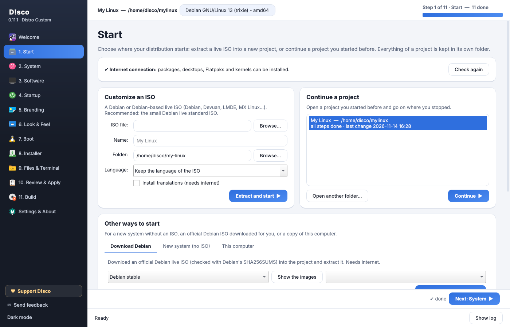

**Other ways to start**: download an official Debian ISO (checked with Debian's SHA256SUMS), make a **new system without an ISO** for a PC, an ARM64 machine, a Raspberry Pi or RISC-V, or copy this computer.


## 4. Moving through the steps

Every step has a bar at the bottom: **Back** goes to the step before, **Next** marks the step done and opens the next one. Skip what you do not want to change: just press Next. The last step has **Finish**, which builds the image.

Most changes do not change the system at once: they wait in **Review & Apply** (step 10), so you can check them first. The blue button at the top shows how many wait.

A step opens after the one before it is done. Experts can open every step at any time: **Settings → Free navigation**.


## 5. Step 2 · System

Tabs: **Repositories** (Debian or Devuan release, mirror, extra repositories with their keys), **Identity** (name, version, website, computer name), **System files**, **Users** (the live user, passwords, more accounts) and **Language** (language, keyboard, time zone).

**System files** edits the files that tell who the system is. **Template from Identity** fills a file for you; change it, then **Save to the system**.

| File | Example |
|---|---|
| /etc/os-release | NAME="My Linux" · VERSION="1.0" · ID=mylinux · PRETTY_NAME · HOME_URL · LOGO |
| /etc/lsb-release | DISTRIB_ID="My Linux" · DISTRIB_RELEASE=1.0 · DISTRIB_DESCRIPTION |
| /etc/issue | Welcome to My Linux 1.0 - \n \l |
| /etc/issue.net | Welcome to My Linux 1.0 |
| /etc/hostname, /etc/hosts | mylinux · 127.0.1.1 mylinux |
| /etc/motd | the message after logging in |

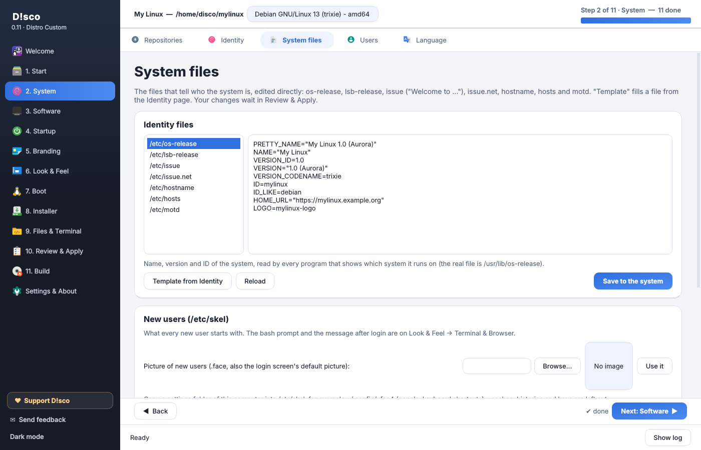


## 6. Step 3 · Software

**Desktop**: choose a desktop (Xfce, GNOME, KDE Plasma, Cinnamon, MATE, LXQt...) or a window manager and how complete it is. The login screen and session follow it.

**Packages**: **Popular applications** lists programs by category with tick boxes: tick them and press **Install ticked**. Below it, every Debian package can be searched, added or removed, and the applications of the ISO can be removed.

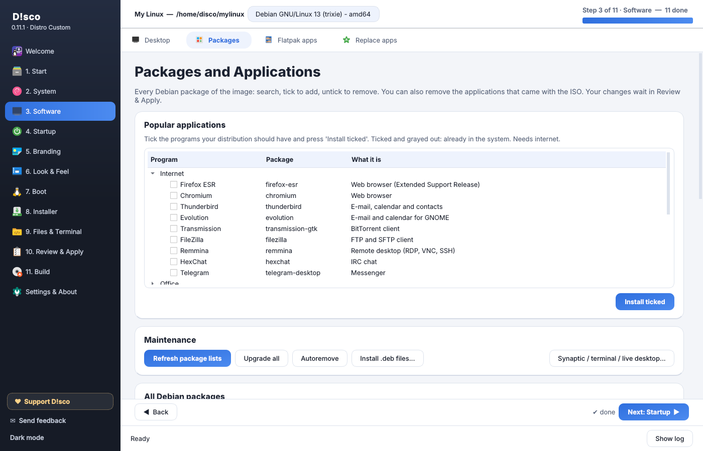

**Flatpak**: applications from Flathub, in the ISO or installed at the first start. **Default apps**: another browser, mail program, editor or terminal for everyone.


## 7. Step 4 · Startup

What starts by itself, switched on or off with a tick:

- **Services** start with the system, before anyone logs in (network, printing, SSH, Bluetooth, updates...). 🔒 marks services the system needs: they stay on.
- **Programs after login** start on every user's desktop (/etc/xdg/autostart).
- **Add a program**: a name and a command, for example a welcome page in the browser.

Change the ticks and press **Apply the ticks**. Turning off what you do not need makes the system start faster.

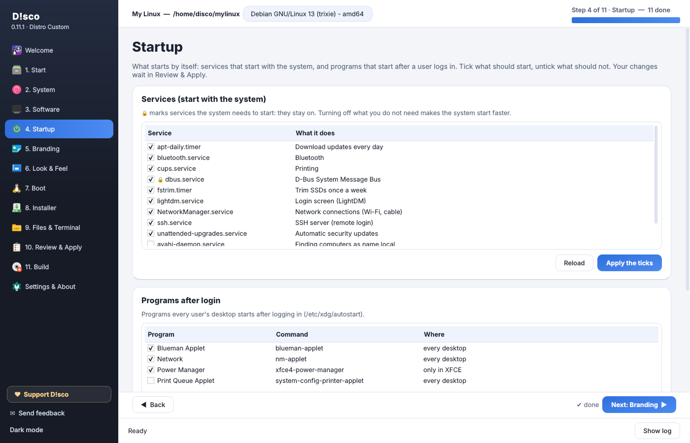


## 8. Step 5 · Branding

**Wallpaper & Logo** is the easy way, the same for every picture:

1. Press **Choose...** (or drop a picture on its box).
2. Keep **Set as default** ticked (untick it to only add the picture to the system).
3. Press **Apply**. Pictures: desktop wallpaper, logo, login screen, boot menu, picture of new users. **Apply all chosen pictures** does them all.

The **logo** goes everywhere: menu and system icon, os-release LOGO, login screen, installer and a boot splash made from it.

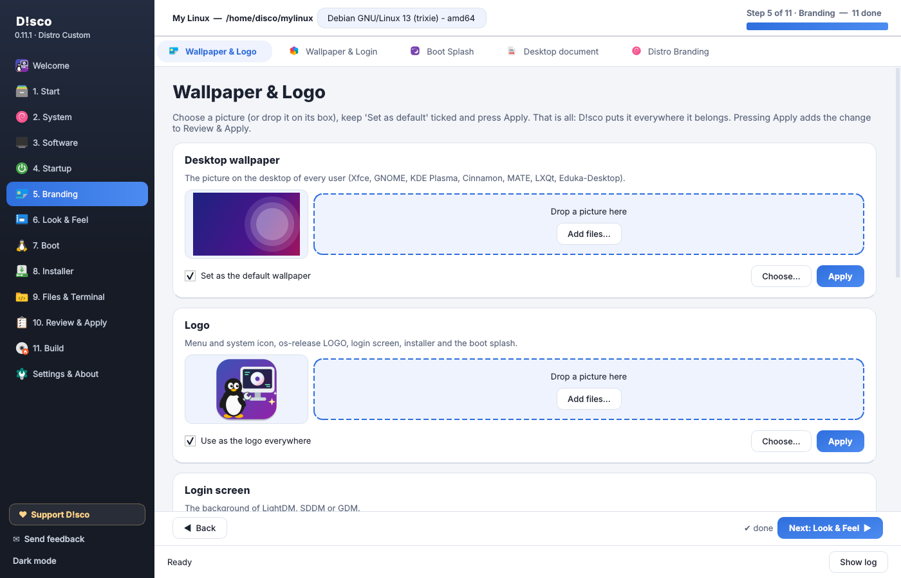

The other tabs: **Wallpaper & Login** (a wallpaper gallery and login screen themes), **Boot Splash** (Plymouth themes), **Desktop document** (a PDF with any title about your system, put on every user's desktop) and **Distro Branding** (a package with your name and logo everywhere).

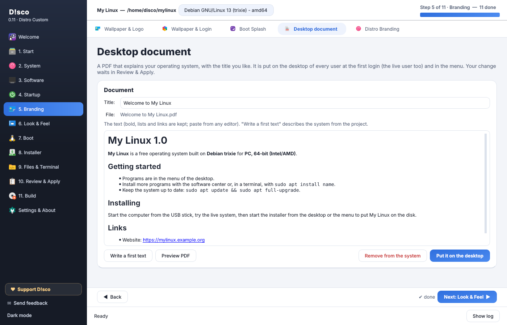


## 9. Step 6 · Look & Feel

**Themes & Icons**, **System Sounds**, **Welcome Screen** (pages shown after the first login) and **Terminal & Browser**: the message after login, the bash prompt of every user, and the home page, bookmarks and privacy of Firefox ESR and Chromium.

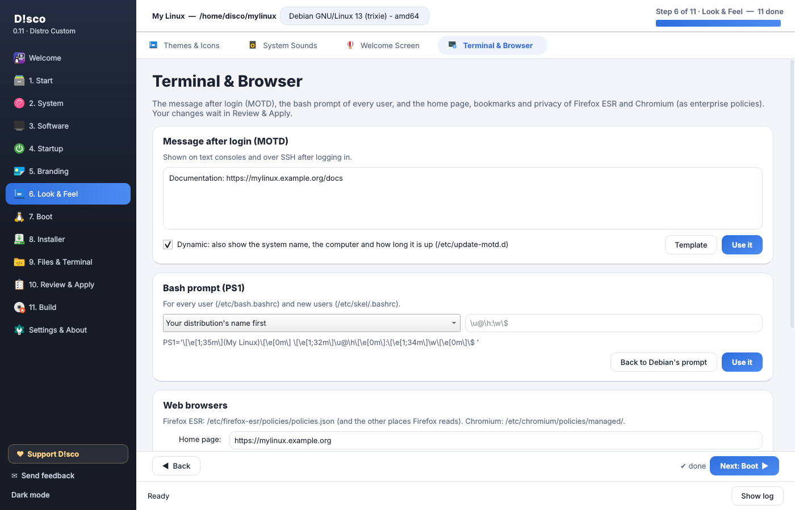


## 10. Step 7 · Boot

**Kernel** (Debian kernels, backports, third-party kernels, firmware), **Boot Loader** (what installed computers start with: GRUB, systemd-boot, rEFInd, EFISTUB, Syslinux), **Boot Menu** (the menu of the ISO), **Init System** (systemd, SysVinit, OpenRC, runit) and **Raspberry Pi** (config.txt, kernel options, image size).

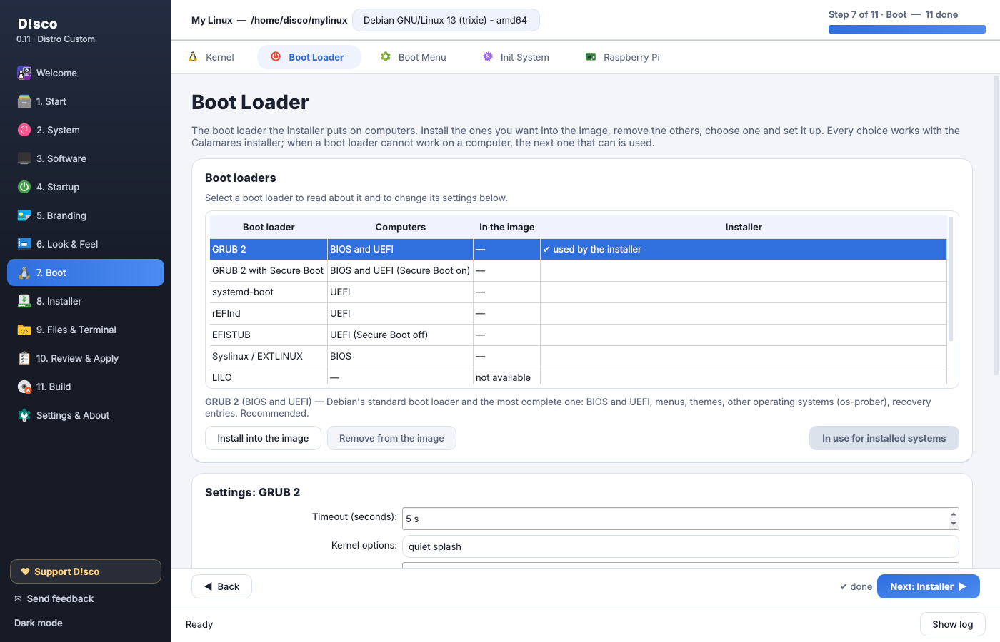


## 11. Step 8 · Installer

**Which installer**: Calamares (recommended), none (a live system only), or **your own .deb packages**: drop them on the page and press **Install them now**. **Save** makes the system match the choice: it offers to install Calamares, or to take it out for *none* and for your own packages. Below it: the name, pictures, slides and rules of Calamares, and **Check the installer**.

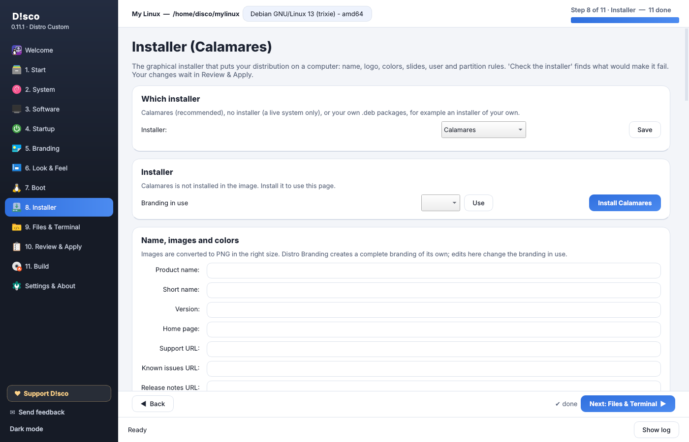


## 12. Step 9 · Files & Terminal

**Your folders** belong to you: open them in your own file manager and add, change or delete anything, **no administrator rights needed**.

| Folder | What it is for |
|---|---|
| overlay | files for the system: overlay/etc/skel/.bashrc becomes /etc/skel/.bashrc |
| hooks | your scripts (*.sh), run inside the system |
| branding | your pictures and documents |
| debs | your own .deb packages |
| iso | the boot menus and splash pictures of the ISO |
| output | the finished ISO and SD-card images |

**Copy my files into the system** copies overlay into the system with owner root; **Run my scripts** runs the scripts. **Give me full access** hands the folders to you again.

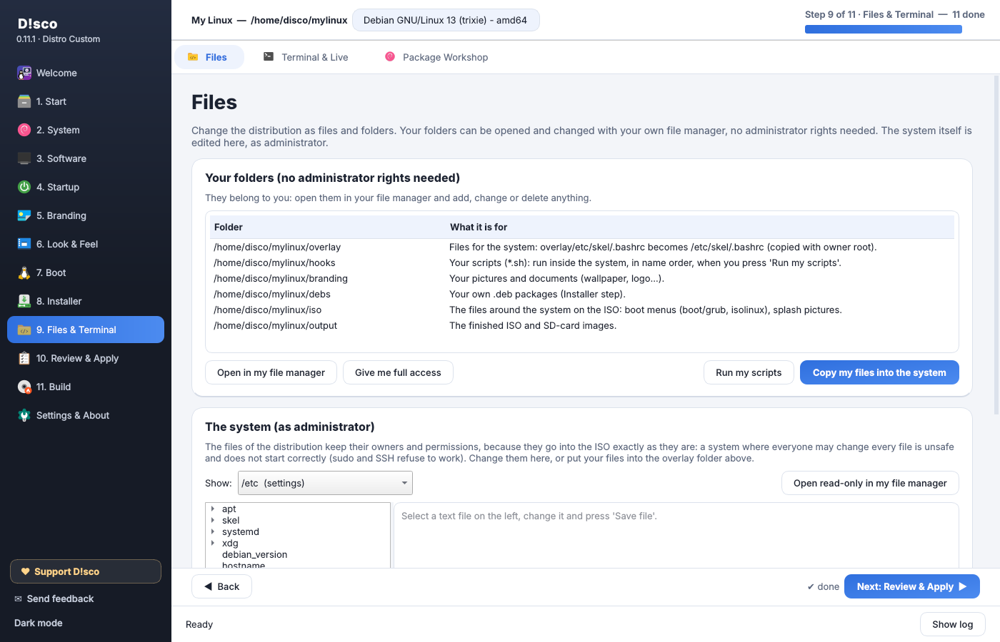

**The system** is changed as administrator, here in D!sco: choose a folder (/etc, /etc/skel, /usr/share...), select a file, change it and press **Save file**.

> **WARNING: The system folder is not opened for everyone on purpose: its owners and permissions go into the ISO as they are, and a system where everyone may change every file is unsafe and does not start correctly (sudo and SSH refuse to work). Use the overlay folder instead.**

**Terminal & Live**: a terminal inside the system and the desktop of the system in a window. **Package Workshop**: change the files of an installed Debian package.


## 13. Step 10 · Review & Apply

Every change of steps 2 to 9 waits here. Tick the ones you are sure about, **Try them first** in a preview if you like, then **Apply all changes**.

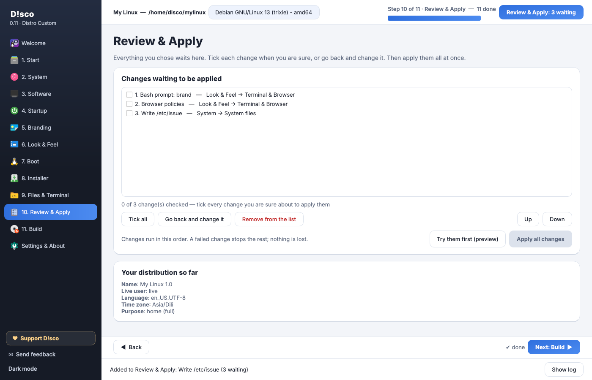


## 14. Step 11 · Build: Finish

Press **Finish: build the image** (or **Build ISO image**). D!sco checks the system first and says how to fix each problem: **Fix automatically**, or double-click a row to open the right step.

Choose a target size if you like (100 MB to 4.4 GB). Compression is lossless: a smaller ISO only takes longer to build. For a Raspberry Pi project the button builds the SD-card image.

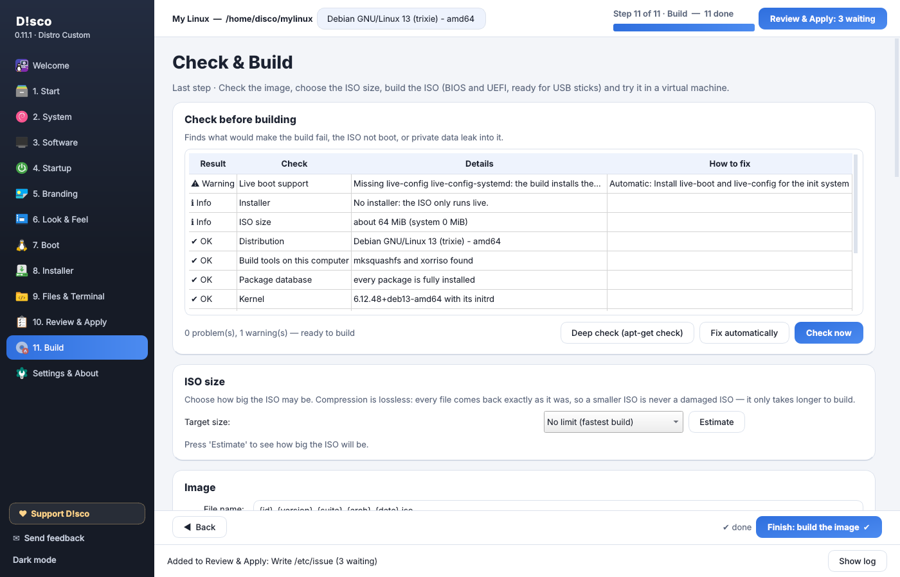


## 15. Testing and writing the image

**Boot ISO** starts the ISO in a virtual machine (QEMU). Then write it to a USB stick:

```sh
lsblk                     # find the USB stick, for example /dev/sdb
sudo dd if=mylinux-1.0-stable-amd64.iso of=/dev/sdX bs=4M status=progress oflag=sync
```

> **WARNING: dd erases everything on the device named in of= without asking. A wrong letter erases your own disk: check it with lsblk first. GNOME Disks (Restore Disk Image) is safer.**

An SD-card image for the Raspberry Pi:

```sh
xzcat mypi-1.0-stable-arm64.img.xz | \
    sudo dd of=/dev/sdX bs=4M status=progress conv=fsync
```


## 16. Raspberry Pi, ARM64 and RISC-V

Start with **Other ways to start → New system (no ISO)** and choose the platform:

| Platform | Processor | Result |
|---|---|---|
| PC, 64-bit / 32-bit (Debian 12) | amd64 / i386 | ISO, BIOS + UEFI |
| ARM 64-bit with UEFI | arm64 | ISO, UEFI |
| Raspberry Pi 3, 4, 400 (and 5, experimental) | arm64 | SD-card image |
| Raspberry Pi 2, 3 (32-bit) | armhf | SD-card image |
| Raspberry Pi 1, Zero | armel | SD-card image |
| RISC-V 64 with UEFI (experimental) | riscv64 | ISO, UEFI |

Other processors run through qemu-user on your PC:

```sh
sudo apt install qemu-user-static binfmt-support
```

SD-card images are laid out like Debian's own (RASPIFIRM boot partition, RASPIROOT system partition that grows to the whole card). Before the first start, `sysconf.txt` on the boot partition can set the computer name and an SSH key:

```sh
hostname=mypi
root_authorized_key=ssh-ed25519 AAAA... you@laptop
```

The card has the account of the **Users** page. While it has the well-known password (`live`) or none, it logs in over SSH with a key only: set a password of your own on System → Users, or change it with `passwd` after the first start.

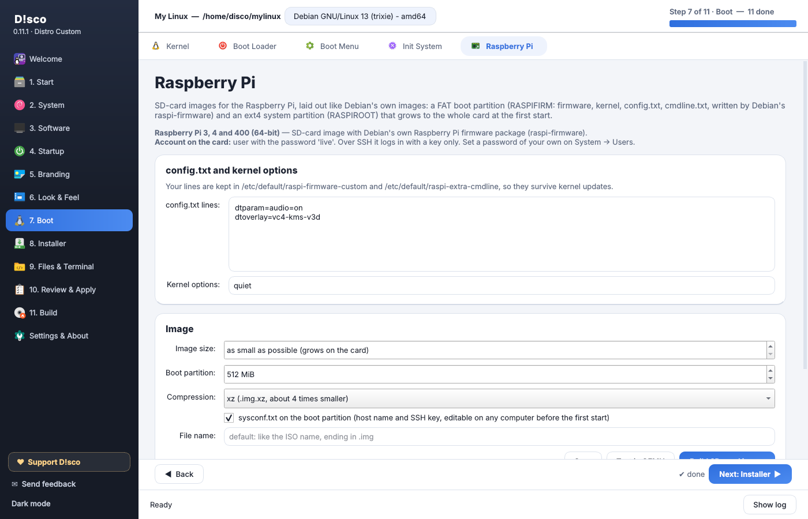


## 17. Command line

Everything also works in a terminal (the commands apply each change at once):

```sh
sudo disco new --iso debian-live-13.1.0-amd64-standard.iso /home/disco/mylinux
cd /home/disco/mylinux
sudo disco brand identity name="My Linux" version=1.0
sudo disco apt install vlc gimp
sudo disco check --fix
sudo disco build --target-size 700
sudo disco test
disco platforms        # what D!sco builds for
disco --help           # every command
```

For automated builds: presets, package lists and `disco build-all`, or Debian's live-build with `disco live-build export`.


## 18. Troubleshooting

| Problem | What to do |
|---|---|
| No internet connection | Connect, then press Check again on Start. Editing works offline. |
| NO_PUBKEY / signature errors from APT | Add the key of the repository (Repositories → Add) or install the keyring package (debian-archive-keyring, devuan-keyring). |
| Kernel panic or 'Unable to find a medium' at live boot | live-boot or the initramfs is missing: Build → Fix automatically. |
| Exec format error (ARM or RISC-V system) | sudo apt install qemu-user-static binfmt-support |
| The system is still in use | Close the terminal or live session of the system, or Unmount everything (Files & Terminal → Terminal & Live). |
| A button did nothing | Look at the log at the bottom (Show log) or /tmp/disco/disco.log, and use Send feedback. |


## 19. Cleaning up

The build folders are big. After a build, closing the window (or **Keep only the ISO** on Build, or `sudo disco clean --keep-iso`) deletes everything of the project but the images. Nothing is deleted while anything is mounted inside the project.

> **WARNING: Never delete a project folder with rm -rf while a terminal or live session of it is open: /dev and /proc of your computer are mounted inside it.**


## 20. License, trademarks and support

D!sco is free software under the GNU General Public License version 3 or later, WITHOUT ANY WARRANTY. The licenses of its components are on the About tab of Settings & About.

Debian is a registered trademark of Software in the Public Interest, Inc.; Raspberry Pi is a trademark of Raspberry Pi Ltd; Linux® is the registered trademark of Linus Torvalds. D!sco is not affiliated with them. Give your distribution a name and logo of its own. The penguin of the D!sco logo is a friend of Tux, the Linux mascot.

Made by Hugo Moniz do Rego. If D!sco helps you, a donation keeps the project going:

- PayPal: https://paypal.me/hugocenturion0311
- Facebook: https://facebook.com/hugomonizdorego
- Project: https://github.com/hugomonizdorego/Eduka-Customizer
